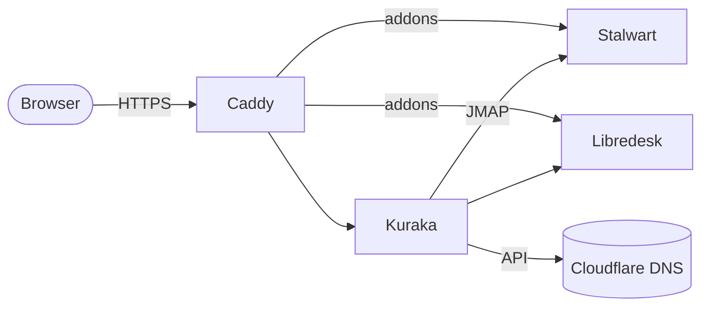

<p align="center">
  
</p>

<h1 align="center">Kuraka</h1>

<p align="center">
  Self-hosted multi-tenant mail admin panel for <a href="https://stalw.art">Stalwart Mail Server</a>,<br>
  with Cloudflare DNS and <a href="https://libredesk.io">Libredesk</a> helpdesks.
</p>

<p align="center">
  <a href="https://github.com/InkaNode/kuraka/releases/latest"></a>
  <a href="https://github.com/InkaNode/kuraka/actions/workflows/ci.yml"></a>
  <a href="LICENSE"></a>
</p>

> In the Inca empire, the *kuraka* governed his community on behalf of the Inca.
> Kuraka lets you hand each customer the keys to their own mail domains.

## What it does

- **Tenants and roles:** superadmins manage everything; each tenant admin sees only their own domains, mailboxes, aliases and quotas.
- **DNS on autopilot:** plans, applies and checks the records Stalwart needs through Cloudflare, or shows them for manual setup.
- **Helpdesks:** deploys Libredesk per tenant and connects mailboxes to it.
- **Branding:** name, logo and colors, global or per tenant, applied to Kuraka, the official Stalwart web interface and Libredesk through small addons, so no forks are needed.
- **Updates from the panel:** Kuraka, Stalwart, its web interface and Libredesk, with a backup first and rollback on failure.
- **Day to day:** mail queue, metrics, IMAP migrations, blocked IP addresses and an audit log, in Spanish and English.

## How it fits



Kuraka is one Go binary with an embedded SQLite database. It talks to Stalwart only through its public JMAP management API, never gets the Docker socket, and keeps Stalwart's admin interface private.

## Install

One VPS with Docker Compose:

```sh
git clone https://github.com/InkaNode/kuraka.git && cd kuraka
cp deploy/.env.example deploy/.env   # set PANEL_HOST, MAIL_HOST, MAIL_DOMAIN, ACME_EMAIL
bash deploy/setup.sh
```

Requirements, DNS and next steps: [docs/install.md](docs/install.md).

## Docs

- [Install](docs/install.md)
- [Architecture](docs/architecture.md)
- [Integrations](docs/integrations.md): Cloudflare, Libredesk, branding and updates
- [UI](docs/ui.md)
- [Changelog](CHANGELOG.md)
- [Contributing](CONTRIBUTING.md): versions and commits

## License

[AGPL-3.0](LICENSE). Copyright © 2026 InkaNode. Not affiliated with Stalwart Labs or Libredesk.

<p align="center"><sub>Powered by InkaNode</sub></p>
