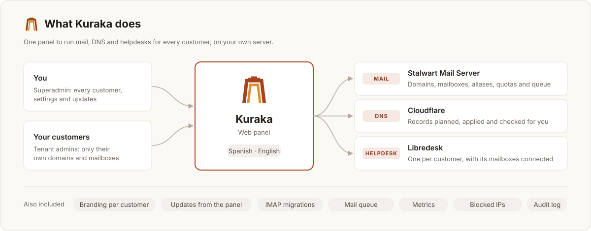
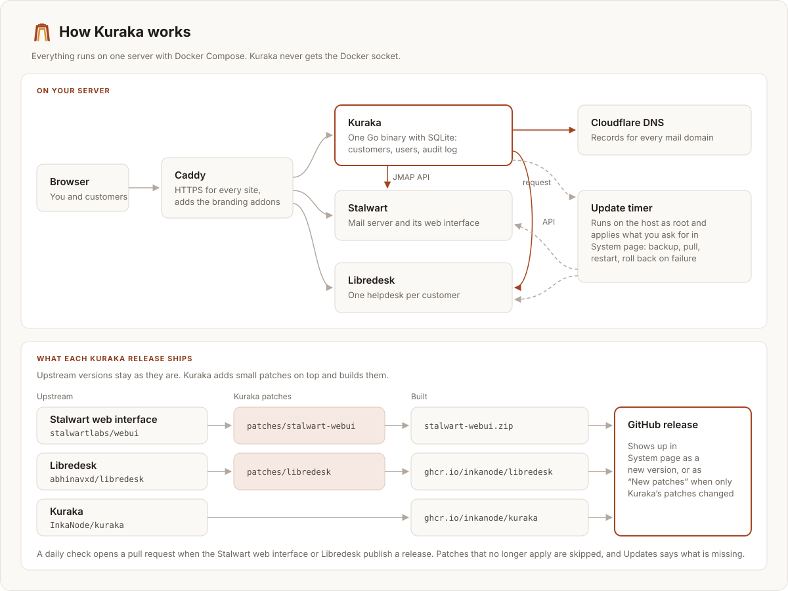

<p align="center">
  
</p>

<h1 align="center">Kuraka</h1>

<p align="center">
  Self-hosted multi-tenant mail admin panel for <a href="https://stalw.art">Stalwart Mail Server</a>,<br>
  with Cloudflare DNS and <a href="https://libredesk.io">Libredesk</a> helpdesks.
</p>

<p align="center">
  <a href="https://github.com/InkaNode/kuraka/releases/latest"></a>
  <a href="https://github.com/InkaNode/kuraka/actions/workflows/ci.yml"></a>
  <a href="LICENSE"></a>
</p>

> In the Inca empire, the *kuraka* governed his community on behalf of the Inca.
> Kuraka lets you hand each customer the keys to their own mail domains.

<p align="center">
  
</p>

## What it does

- **Tenants and roles:** superadmins manage everything; each tenant admin sees only their own domains, mailboxes, aliases and quotas.
- **DNS on autopilot:** plans, applies and checks the records Stalwart needs through Cloudflare, or shows them for manual setup.
- **Helpdesks:** deploys Libredesk per tenant, connects mailboxes to it and adds its live chat to websites.
- **Branding:** name, logo and colors, global or per tenant, applied to Kuraka, the official Stalwart web interface and Libredesk through small addons.
- **Updates from the panel:** Kuraka, Stalwart, its web interface and Libredesk, with a backup first and rollback on failure.
- **Day to day:** mail queue, metrics, IMAP migrations, blocked IP addresses and an audit log, in Spanish and English.

## How it works

<p align="center">
  
</p>

Kuraka is one Go binary with an embedded SQLite database, running next to Stalwart, Caddy and the Libredesk helpdesks on one server with Docker Compose.

- **Stalwart** is used as released. Kuraka talks to it only through its public JMAP management API and keeps Stalwart's admin interface private.
- **The Stalwart web interface and Libredesk** are built from their upstream releases plus a few small patches in [`patches/`](patches) (status icons, an email thread view, an inbox switcher, more automation conditions). Upstream code is never copied into this repository, and each patch says what users lose if it stops applying.
- **Updates:** System › Updates shows the upstream version of each part. A new upstream release shows as a new version; a Kuraka release that only changes the patches shows as **New patches**. A daily job opens a pull request for every new upstream release, and patches that no longer apply are skipped and listed in Updates until they are fixed.
- **Security:** Kuraka never gets the Docker socket. Updates are applied by a small timer on the host that accepts only a validated version, backs up first and rolls back on failure.

## Install

One VPS with Docker Compose:

```sh
git clone https://github.com/InkaNode/kuraka.git && cd kuraka
cp deploy/.env.example deploy/.env   # set PANEL_HOST, MAIL_HOST, MAIL_DOMAIN, ACME_EMAIL
bash deploy/setup.sh
```

You need a VPS with 2 GB of RAM or more, Docker with Compose, ports 25, 80, 443, 465 and 993 open (outbound 25 too) and DNS records for the panel and mail hosts. Requirements, DNS and next steps: [docs/install.md](docs/install.md).

## Docs

- [Install](docs/install.md)
- [Architecture](docs/architecture.md)
- [Integrations](docs/integrations.md): Cloudflare, Libredesk, branding and updates
- [UI](docs/ui.md)
- [Changelog](CHANGELOG.md)
- [Contributing](CONTRIBUTING.md): versions and commits

## License

[AGPL-3.0](LICENSE). Copyright © 2026 InkaNode. Not affiliated with Stalwart Labs or Libredesk.

<p align="center"><sub>Powered by InkaNode</sub></p>
